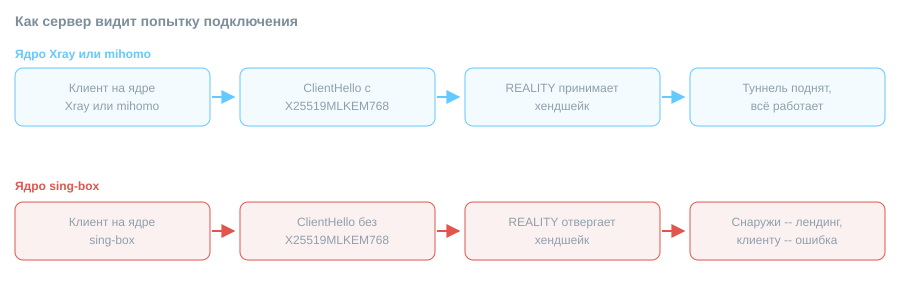

---
date:
  created: 2026-11-24
  updated: 2026-11-24
authors:
  - heavens-dev
categories:
  - Инфраструктура
  - Инциденты
links:
  - Heaven's Gate FAQ: faq.md
  - Как оформлять репорты: additional/bug_reports.md
---

# История о клиентах на базе sing-box и ядре Xray 

Недавно мы подняли новые серверы. Конфиги у людей не менялись, но часть клиентов внезапно начала выдавать ошибку `reality verification failed` или ничего не делать вовсе при подключении. Подозревали сначала конфиги, потом собственные руки (так бывает), а оказалось, что серверы стали требовать от клиента то, чего часть клиентов пока не умеет.

Рассказываем, что произошло и что мы с этим сделали.

<!-- more -->

## Что случилось

У пользователей начала появляться довольно странная ситуация: один сервер работает, второй не подключается вовсе. И это при том, что по нашим тестам все сервера, которые ТСПУ не заблокировало были в полностью рабочем состоянии. 

По логам клиент пишет `reality verification failed`. Конфиг при этом правильный, подписка свежая, интернет есть. Что ж такое-то...

Причина сие недоразумения оказалась на поверхности. Новые серверы мы подняли на свежей версии ядра Xray, а оно начиная с версии 26.9.8 требует от клиента постквантовый хендшейк. Клиенты, которые в него не умеют, сервер просто не пускает.



*Сверху -- путь клиента с постквантовым хендшейком, снизу -- без него. И в том, и в другом случае снаружи сервер выглядит как обычный сайт.*

## Что мы сделали

Серверы по подписке ⛅ **Classic** мы откатили на предыдущую версию ядра. Постквантовый хендшейк там не обязателен, и подключается всё, что умело подключаться раньше, на каком бы ядре ни сидел клиент.

!!! tip "Так и будет оставаться до тех пор, пока мы не будем уверены в том, что все клиенты на всех платформах начали поддерживать новые требования свежей версии ядра Xray."

Серверы по подписке :sun: **Clear** будут разворачиваться на самой актуальной версии ядра, и время от времени обновляться в случае. Откатить их тоже можно было бы, но мы не стали, так как в свежих версиях закрываются уязвимости, по которым ТСПУ проще заметить нас. Бонусом старые фингерпринты Chrome, Firefox и других браузеров сейчас активно режутся DPI.

## Что делать тебе

1. Сменить клиент на поддерживаемый. Во время работы БС, к сожалению, это единственный рабочий вариант.
2. (**Рекомендуется**) Использовать обычные сервера или конфигурацию "Авто", если белых списоков нет.

!!! tip "Если подключение всё равно не строится, напиши нам"
    Как лучше оформить репорт [рассказывали отдельно](../../additional/bug_reports.md).

---

## Инфа для зануд

Дальше идут технические подробности. Читать необязательно, но если тебе интересно, почему всё устроено именно так -- добро пожаловать.

### REALITY и постквантовый key share

REALITY -- способ замаскировать VLESS-подключение под обычный TLS-хендшейк. Клиент представляется браузером, сервер отвечает как обычный сайт, и со стороны сессия выглядит как обычный HTTPS. Свой сертификат серверу для этого не нужен: он "одалживает" рукопожатие настоящего сайта.

С версии 26.9.8 сервер вдобавок ждёт в ClientHello группу `X25519MLKEM768`. Это гибрид обычного X25519 и постквантового ML-KEM (бывший Kyber). Смысл простой: записанный сегодня трафик нельзя будет расшифровать, когда появятся квантовые компьютеры. Клиенты на ядре Xray эту группу шлют, а вот sing-box -- нет: он берёт свежий Chrome-фингерпринт и вручную вырезает из него "лишнюю" группу. Получившийся ClientHello не совпадает с настоящим Chrome (это видно даже по JA4), и сервер его отвергает. В логе клиента это выглядит так:

```text
reality verification failed
```

В логах сервера (Xray с уровнем info) -- так:

```text
REALITY: processed invalid connection
authentication failed or validation criteria not met
```

В конечном итоге клиенту возвращается не подключение по протоколу VLess, а самый обычный TLS-сеанс с selfsteal лендингом, ибо сервер принимает его за случайного посетителя, отдаёт страницу сайта и на этом прощается. Туннеля нет, трафик через сервер не идёт, а клиент остаётся сидеть грустный с ошибкой в логах. Почти загадка!

Такая же история у всех провайдеров, которые уже переехали на свежий Xray: [SagerNet/sing-box#4520](https://github.com/SagerNet/sing-box/issues/4520). Фикс существует пока только в виде патчей и форков, в релиз он не попал. Мы следим за этим ишью, и как только фикс выйдет в релиз, напишем сюда.

### А если выставить minClientVer? Многие говорят, что это помогает!

В трекерах часто советуют поиграть с `minClientVer`, мол, это помогает. Это отдельная проверка минимальной версии клиента, и она тут ни при чём: в свежих версиях Xray порог по умолчанию закомментирован, и мы его не задавали. В том же ишью это проверяли напрямую -- `minClientVer: "1.0.0"` на Xray 26.9.30 не спасает, sing-box всё равно отвергается. Сервер смотрит на состав ClientHello, а не на заявленную версию.

Так выглядит inbound на новых серверах (упрощённо):

```json
{
  "protocol": "vless",
  "settings": {
    "decryption": "none"
  },
  "streamSettings": {
    "network": "xhttp",
    "security": "reality",
    "realitySettings": {
      "target": "s-xx.heavensgate.ru:443",
      "serverNames": ["s-xx.heavensgate.ru"],
      "privateKey": "<приватный ключ>",
      "shortIds": ["<short id>"]
    }
  }
}
```

Про ML-KEM в конфиге ни слова. Это требование самого Xray, поэтому "поправить конфиг, чтобы пускал старые клиенты" нельзя. Либо ядро свежее и старые клиенты не пускаются, либо наоборот.

### XHTTP, второй барьер

Инбаунды наших серверов работают преимущественно на транспорте XHTTP: VLESS упаковывается в обычные HTTP-запросы, и со стороны трафик выглядит как общение с легитимным сайтом, а не как что-то экзотическое ~~и перекосоёбленное приложениями с обходом DPI~~. Апстрим-sing-box XHTTP не поддерживает вообще (умеют отдельные форки со спецсборкой). Так что даже когда key share починят, клиенты на чистом sing-box к XHTTP-инбаундам не подключатся.

### Почему мы не откатили всё

Откатить Classic было для нас очевидным решением: совместимость важнее. Откатить ещё и Clear мы позволить уже не можем.

1. Старые ядра шлют старые фингерпринты Chrome, а ТСПУ учится их вылавливать: у настоящего Chrome лимит около 6 соединений на домен, и подключения, которые прикидываются свежим Chrome и открывают десятки, попадают под раздачу. Автор Xray разбирает это в [обсуждении XTLS/Xray-core#6181](https://github.com/XTLS/Xray-core/pull/6181#issuecomment-4567373533) и советует держать количество соединений близким к браузерному (у XHTTP это настройка `maxConnections`).
2. В свежих версиях закрываются уязвимости, по которым протокол проще обнаружить. Откатываясь, мы замораживаем сервер на слабостях, которые уже известны.

Пока sing-box не выпустит фикс, к Clear подключатся только клиенты на ядрах Xray и mihomo.

### Как мы это проверяли

Методом научного тыка и продвинутого гуглинка, как же ещё. Когда пошли первые жалобы, мы первым делом посмотрели версию ядра на новых нодах:

```bash
$ docker exec remnanode xray version
Xray 26.11.9 (Xray, Penetrates Everything.) 676eaf6 (go1.27.3 linux/amd64)
```

26.11.9 > 26.9.8.

Заодно проверили, как сервер выглядит снаружи:

```bash
$ curl -sI https://s-xx.heavensgate.ru/
HTTP/2 200
```

По домену ноды открывается наш selfsteal лендинг: сервер "крадёт" сертификат и страницу сам у себя, и случайный посетитель видит сайт, а не ошибку TLS. Всё так и задумано.

### Итого

Если коротко:

1. Xray 26.9.8+ ждёт в хендшейке `X25519MLKEM768`, а sing-box его вырезает -- отсюда и `reality verification failed`.
2. XHTTP sing-box не умеет совсем, так что фикс первого барьера второй сам по себе не отменит.
3. Ждём [фикс #4520](https://github.com/SagerNet/sing-box/issues/4520). Как только он выйдет в релиз -- обновим пост.
